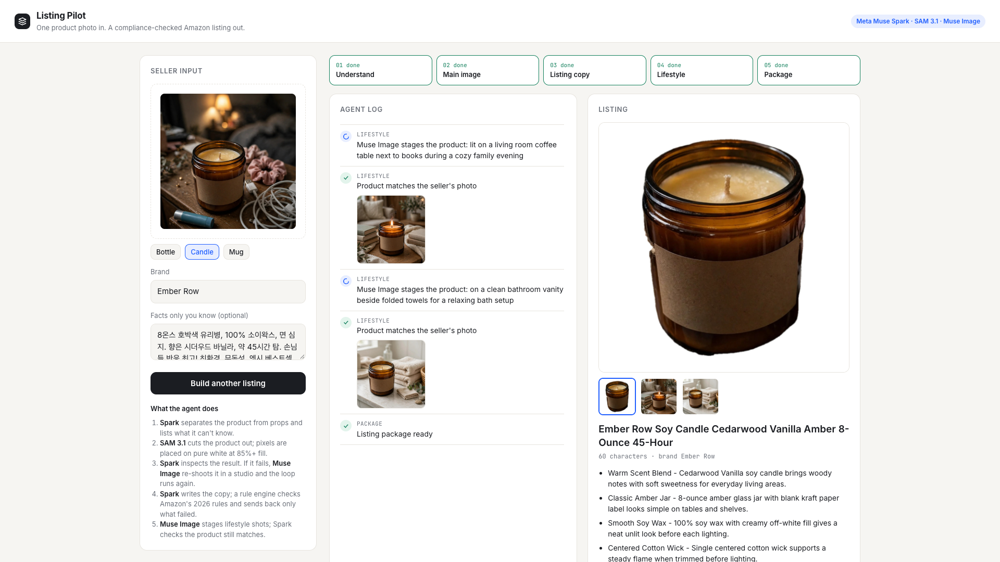
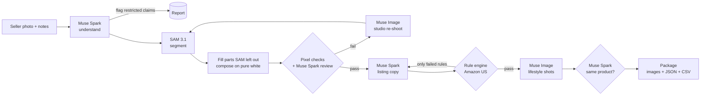
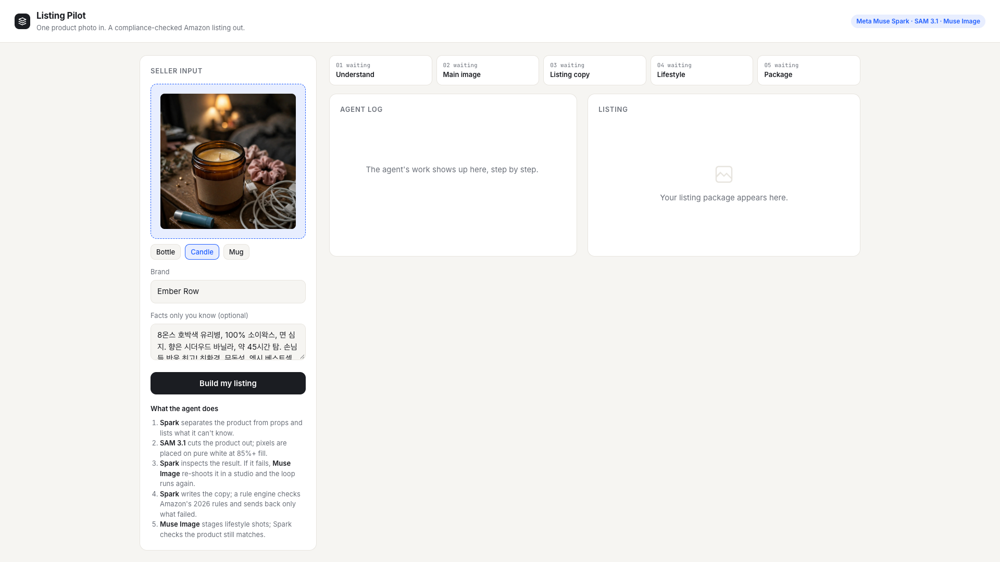
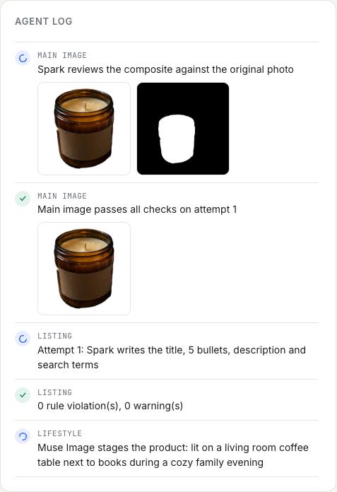
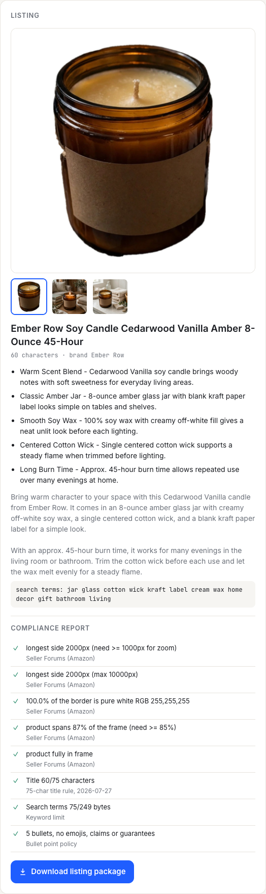

# Listing Pilot

> **One product photo in. A compliance-checked Amazon listing out.**
> An agent for one-person Amazon shops, built on Meta's models: Muse Spark, SAM 3.1 and Muse Image.



Demo video (2:54): [`docs/demo/listing_pilot_demo.mp4`](docs/demo/listing_pilot_demo.mp4). The whole video is one live run on the Meta Model API. Stretches where the agent works and nobody talks are sped up 4x and marked on screen.

## Problem

A solo seller (candle maker, potter, small importer) has a phone photo of the product on a cluttered table and a few notes, often not in English. Amazon expects a lot before a listing goes live:

- **Main image:** pure white background (RGB 255,255,255), the product filling about 85% of the frame, no props, text, logos or borders, at least 1000 px for zoom.
- **Title:** at most 75 characters for non-media categories (from 2026-07-27), no `! $ ? _ { } ^`, no word more than twice, no ALL CAPS, no promotional words.
- **Bullets and description:** no guarantees or refund promises, no URLs or contact details, no emojis, and no restricted claims such as *eco-friendly*, *antibacterial* or *non-toxic*.
- **Search terms:** at most 249 bytes, no brand names, ASINs, repeats or words already in the title.

Small sellers write exactly the things that get listings suppressed ("Eco-friendly! Bestseller! Full refund if not satisfied"). A plain LLM prompt does not reliably follow these rules either, and an image generator will happily invent a product that isn't the one being sold.

## What it does

1. **Understand.** *Muse Spark* reads the photo and the seller's notes in any language. It separates the product from the props, records confirmed specs, and lists what the photo cannot prove (capacity, dishwasher safe, and so on). Restricted phrases in the notes are flagged for the seller and kept out of the copy.
2. **Main image.** *SAM 3.1* segments the product. Plain code fills parts SAM leaves out (a wrap-around label, the wax in a jar), keeps real openings (a mug handle), places the cut-out on pure white at 87% fill, and checks the pixels.
3. **Review and repair.** *Muse Spark* compares the composite with the original photo for cut-out artifacts, props, text, and whether it is still the same product. If anything fails, *Muse Image* re-shoots the product as a clean studio packshot, SAM cuts it out again, and the loop repeats (up to 3 attempts).
4. **Copy.** *Muse Spark* writes the title, 5 bullets, description and search terms from the confirmed facts. A rule engine checks every Amazon rule above. Only the failed rules go back to the model ("Title is 98 characters; the limit is 75"), and only that part is rewritten.
5. **Lifestyle images.** *Muse Image* stages the cut-out in two realistic scenes. *Muse Spark* checks that the product still matches the seller's photo and regenerates once if it drifted.
6. **Package.** Images, `listing.json` and a flat `listing.csv` (item name, bullets, description, keywords, image files) in one zip, plus a compliance report showing which checks passed.

The models decide *what* the product is and *where* it is. Plain Python decides *whether it passes*. The checkers are the source of truth, so a model cannot talk its way past a rule.

## How each Meta model is used

| Model (Meta Model API) | Where | What it does |
|---|---|---|
| `muse-spark-1.3` (vision + text, JSON schema output) | `meta.understand` | Product facts, props, uncertain specs, a SAM prompt noun, scene ideas, and an English rendering of the seller's notes |
| | `meta.review_image` | Strict visual review of each candidate image against the original photo |
| | `meta.write_listing` | Listing copy, and targeted fixes when the rule engine fails it |
| `sam-3.1` (Responses API stream, parsed with `meta-sam-parser`) | `meta.segment` | Text-prompted product mask ("candle jar"), with a fallback noun if only part of the item is cut out |
| `muse-image-1.0` (image edit) | `meta.studio_retouch` | Repair path: a clean studio packshot of the same product when the cut-out fails review |
| | `meta.lifestyle` | In-context lifestyle shots built from the approved cut-out |

The API is OpenAI-compatible (`https://api.meta.ai/v1`), so the code uses the `openai` SDK with `base_url` set.

## Architecture



| File | Role |
|---|---|
| `app/pipeline.py` | The agent: steps, retry loops, events streamed to the UI, packaging |
| `app/meta.py` | Thin wrappers for Muse Spark, SAM 3.1 and Muse Image (plus mock answers) |
| `app/imaging.py` | Hole filling, compositing on white, pixel checks. No API calls |
| `app/checks.py`, `app/rules.py` | Listing rule engine, with the public Amazon source for each rule |
| `app/server.py`, `app/static/index.html` | FastAPI app with a live agent log (server-sent events) |

## What a real run looks like

The candle sample, with the seller's notes in Korean. In English: *"8 oz amber glass jar, 100% soy wax, cotton wick, cedarwood vanilla, about 45 hours. Customers love it! Eco-friendly, non-toxic, Etsy bestseller, full refund if you are not satisfied."*

| Seller input | Agent log |
|---|---|
|  |  |

- Flagged and left out: *eco-friendly* (restricted claim), *non-toxic* (needs proof), *bestseller* (promotional), *full refund* (guarantee wording).
- Main image: 2000 px, 100% pure white border, product fills 87% of the frame.
- Title (60 characters): `Ember Row Soy Candle Cedarwood Vanilla Amber 8-Ounce 45-Hour`.
- In other live runs during development, the review loop caught rough cut-out edges and a label SAM had left out, and Muse Image re-shot the jar. The rule engine also caught a bullet starting in lowercase, and the rewrite fixed only that bullet.



## Run it

```bash
python3 -m venv .venv && .venv/bin/pip install -r requirements.txt
cp .env.example .env        # put your Meta Model API key in MODEL_API_KEY
.venv/bin/uvicorn app.server:app --port 8000
# open http://localhost:8000, pick a sample (Mug, Candle, Bottle) or drop your own photo
```

- `MODEL_API_KEY`: key from [dev.meta.ai](https://dev.meta.ai).
- `LP_MOCK=1`: no API calls. Every model returns a canned answer (deliberately non-compliant copy first), so you can see the UI, the rule engine and the repair loop without spending credits. Mock mode is also used automatically when no key is set.
- At most two runs build at once (a credit guard). A typical live run takes 60 to 100 seconds.

Tests: `.venv/bin/python -m pytest -q` checks that the rule engine catches a deliberately bad listing (length, characters, caps, promotion, emoji, guarantees, contact details, ASINs, brand in keywords) and passes a clean one.

The sample photos in `samples/` were generated with Muse Image by `scripts/make_samples.py`, so the demo uses no third-party product photos. The demo video is recorded by `scripts/record_demo.py`, with narration from `scripts/demo_tts.py`.

## Limitations

- The agent does not log in to Seller Central or submit anything. The output is a package for the seller to review and upload. The CSV is a plain flat file, not Amazon's category-specific template, which needs a seller login to download.
- Rules cover Amazon.com (US), checked on 2026-10-28 against public Amazon-owned pages (linked in `app/rules.py`). Seller Central help pages are login-gated. Rules that are commonly enforced but can't be quoted from an official page are shown as warnings, not failures.
- Lifestyle images are generated. The agent checks them for product drift, but the seller should still look at them before publishing.
- No Amazon logos, trademarks or screenshots are used in the app or the video.

## Hackathon

Built from scratch during the **Meta Global AI Developer Hackathon (Oct 26 – Nov 4, 2026)**. Indie developer track, theme *Build for Your World*. The first commit is from Oct 28, 2026.

## License

MIT, see [LICENSE](LICENSE).
